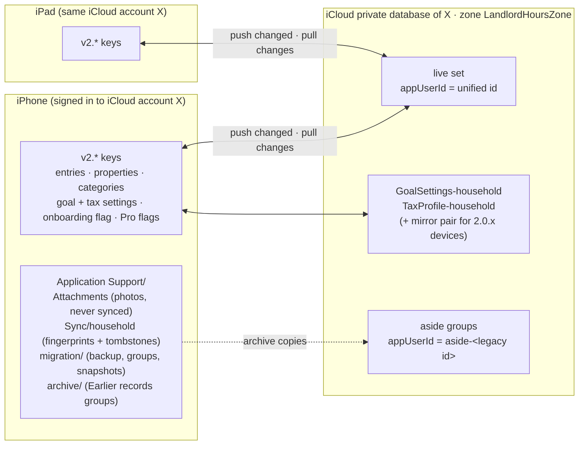
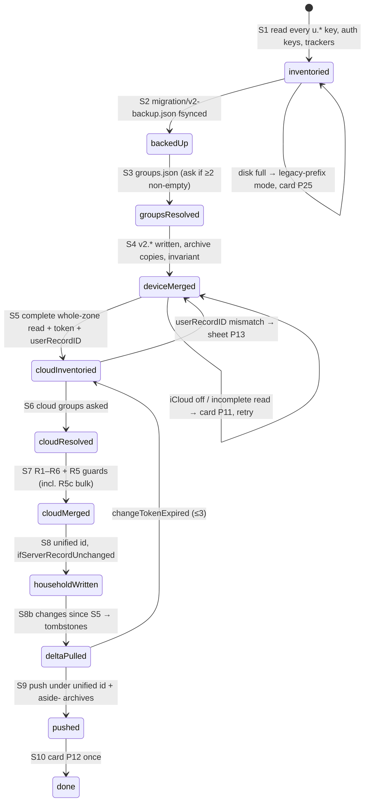

# Package K: one identity, records that follow you (2.2)

2026-10-25, r2. Author: architecture lane (Fable 5.1). Status: **PLAN, reviewed (independent critic: READY AFTER FIXES, all applied in §9), awaiting Brian's two decisions (§8)**. Design only; no code on this branch.

Companion to `v2-revamp-plan.md` (packages 0, A–J) and `DESIGN-STANDARD.md`. The engineering design it builds on is the identity direction v2 → v4 (`~/AgentScratch/landlordhours/2026-10-23/identity-redesign/direction-v{2,3,4}.md`, four adversarial rounds, verdict "safe to build"; the one-page summary Brian saw is the "One you" artifact). This document does not restate those rules; it decides what ships in 2.2, maps every existing user state onto the model, fixes the package's files and hand-offs against §4 of the revamp plan, sets the test bar, and ranks the risks. Where it changes v4, it says so (§2.4).

Code read on `origin/int/2.1-v2` at `0a04f5d` (contains the 2.0.1 fix `188cacd`): `Sources/Services/LocalProfile.swift`, `AppleSignIn.swift`, `CloudKitSyncService.swift`, `SyncChangeTracker.swift`, `LegacyProfileFixture.swift`, `Sources/ViewModels/AppViewModel.swift`, `Sources/Views/ProfileManagementViews.swift`, `ContentView.swift`, `SettingsView.swift`, `DeleteAllDataView.swift`, `Onboarding/OnboardingView.swift` (and the same file on `v2/b` at `868d2c3`), `LandlordHours.entitlements`, `Tests/*Profile*`, `Tests/AccountDeleteTests.swift`, `UITests/SignInReplacementUITests.swift`. Release naming: this package ships in **2.2** (the integration branch keeps its `int/2.1-v2` name); what the direction docs call "2.2 cleanup" is **2.3** here.

---

## 0. Why 2.0 broke, in one paragraph (verified)

Every record is keyed twice: on the device under `u.<id>.*` (`UserScope.key`, `AppViewModel.swift:13-31`) and in one CloudKit private zone `LandlordHoursZone` as `appUserId = <id>` (`CloudKitSyncService.swift:54, 723-734`). The `<id>` is whichever of three unrelated things is active: an Apple user id, a `local-<UUID>`, or a 1.0.6 `email-<address>` (`ProfileKeys.resolveUserId`). The pull drops every record whose `appUserId` is not the active id (`:723-734`), and the three ids never join. So a 1.x user who opens 2.0 and taps "Get started" gets a new `local-…` id and an empty zone view; a user who signs in with Apple gets a third id; Restore is the only bridge, and it is a manual tap on a list. 2.0.1 patched the symptoms (Welcome keeps Sign in and Restore until onboarding finishes; Restore lists every id; discovery errors are shown; teardown before Apple sign-in; per-profile name copies; pull-first guard). The model is unchanged.

**Brian's own case, re-read.** The direction docs assume his 1.x records are in CloudKit under `email-brianlevu@gmail.com` and were invisible to 2.0 because of the owner filter. There is a second, simpler reason Restore found nothing on his phone: the founder build installed on BLV-Phone on 2026-10-21 was a **development-signed** build, which talks to the CloudKit **Development** environment (`session-learnings`: "installed (Development iCloud)"). His 1.x records were written by App Store builds into **Production**. A Development build can never see them, whatever the filter does. The App Store 2.0.1 build does use Production, so its Restore sheet is the first honest check (§3.5). None of this changes the design; it changes the recovery ladder's first rung.

---

## 1. The target model

### 1.1 In plain words

- **One identity: the iCloud account the device is signed in to.** There is no sign-in, no profile, no account to create. Open the app, your records are there.
- **One record set per iCloud account**, stored in the user's own CloudKit private database (zone `LandlordHoursZone`, as today) and mirrored on every device signed in to that account. On the device the set lives under one fixed key prefix (`v2.*`) plus the existing `Application Support` files. Nothing of the user's leaves their device and their iCloud; we hold no server.
- **Spouse is a participant, not an identity.** Every entry already carries `participant = Self | Spouse` (`Models.swift:161`). A household is one iCloud account with both people's hours inside one set. Two phones on the same iCloud see the same set. (Two phones on two iCloud accounts cannot share a set in 2.2; see §6, not-in-2.2.)
- **There is no sign-out.** The only switches are the iPhone's own: iCloud on or off for LandlordHours (records stay on the device when off), and **Delete all data**, which removes everything from this device and from iCloud (the whole zone, one atomic operation). That keeps App Store 5.1.1(v) satisfied regardless of whether Apple reads a no-account app as "supports account creation": a user can erase everything we hold, in the app, in two taps.
- **Earlier records are a safety net, not a door.** Anything the app could not merge on its own (a second set of records it is not sure is yours, records removed on another device, records from a different iCloud account) is listed under Settings › iCloud & records › **Earlier records**, with "Add to my records", "Put back", "Undo" and "Delete". Nothing is ever deleted by the merge; removed records sit in **Recently removed**: 30 days when the user deleted them on another device, until the user acts when the app inferred the removal (§2.4).
- **Sign in with Apple is removed** (§8, decision 1). It never held a token (`AppleSignInFlow.record` stores only `credential.user`), it cannot move records between iCloud accounts (the data is in the iCloud private database either way), and it is one of the three ids that broke 2.0. Users keyed to an Apple id are just another group to merge.

### 1.2 Where records live

Facts the diagram rests on: one zone and one container (`iCloud.com.openclaw.landlordhours`) since the first CloudKit commit `fe6486c` (2026-02-26), so no 1.x records live anywhere else; record names are UUIDs; the only per-owner records are the settings pair; attachments never sync (`CloudKitSyncService.swift:1207-1230`).

### 1.3 How each kind of user ends up with their records

| Who | What the device holds on first 2.2 launch | What the zone holds | What happens, with no tap unless stated |
|---|---|---|---|
| **New user** | nothing | nothing | Welcome → onboarding → Today. Unified id `household`. iCloud off: records stay on the device; Today card P10 after the first entry. |
| **Returning 1.x user (1.0.6 → 2.2)** | `u.email-<addr>.*` and `emailUserId` (if still installed) | `appUserId = email-<addr>` | One group on device, same group in the zone: union by UUID, deletes honoured (R3/R5), settings from that group → household pair. Welcome is skipped (onboarding flag carried, R14); Today opens with everything; one-time card P12. If 1.0.6 was signed out with two email profiles on the device: the two-sets question (§1.5). |
| **2.0.x user, local profile** | `u.local-<UUID>.*` | `appUserId = local-<UUID>` | Same as above with the local id as the group. |
| **2.0.x user, Apple sign-in** | `u.<appleId>.*` | `appUserId = <appleId>` | Same. The Apple id is just the group's name; nothing asks them to sign in again. If the device also holds a half-made `local-…` from "Get started" (Brian's 2.0 shape) and it is empty, it is dropped silently (an empty group is never primary and never asked about). |
| **2.0.x user with two or more non-empty groups** (signed out and started again; spouse used a second profile) | two `u.<id>.*` sets | one or two groups | Device merge of the primary first, then the question (§1.5) once per secondary group; app usable meanwhile. |
| **Same user, new phone, same iCloud** | nothing | the live set under the unified id (or legacy groups, if no 2.2 device migrated yet) | Welcome shows "Checking iCloud for earlier records…" (≤ 8 s), then "We found N hours from an earlier version. They're already here." and the button reads Continue. Onboarding answers made before the cloud read lands are `dirtyWhileEmpty` and never overwrite the household settings (v4 §3.3). |
| **Same user, new phone, different iCloud account** | nothing | nothing in *this* account's database | Fresh start. We cannot see another iCloud account's private database. Settings says plainly: "Your records are in the iCloud account you used before." (P8 variant). No promise we cannot keep. |
| **Brian** | 2.0.1 App Store build: an Apple-id group (empty or near-empty) and maybe an empty `local-…` | unknown until checked (§3.5) | If the zone holds `email-brianlevu@gmail.com` records: one non-empty cloud group, no question, everything arrives on first pull. If the zone is empty: nothing to recover; the honest branch in §3.5. |

### 1.4 Delete all data, iCloud off, account changed

- **Delete all data** (Settings › iCloud & records, the existing hold-to-delete page): `CKModifyRecordZonesOperation` deletes the zone, then every `v2.*` key, every `u.*` key, the archive, the backup, attachments, notification keys, the widget snapshot. The "iCloud is off, delete from this iPhone anyway?" branch stays. After it: Welcome, as a new user. **Zone-gone guard (review fix 1):** today `handleZoneGone` (`CloudKitSyncService.swift:603-610`) recreates the zone and re-uploads every local record, so any other device on the account puts the deleted data straight back. In 2.2 a `userDeletedZone` / `zoneNotFound` on a device that previously synced **stops sync and asks** (sheet P31: "Your records were deleted from iCloud on another device. Keep this iPhone's copy and put it back in iCloud, or delete it here too?"); it never recreates the zone on its own. The delete page says "Delete on your other devices too, or they will offer to put the records back." 2.0.x devices cannot be changed; release notes and P20 copy carry the warning.
- **iCloud off** (no account on the device, or LandlordHours switched off in iCloud settings): the device set is the only copy; the status row says so; a Today card once after the first saved entry.
- **Other account statuses (review):** `.restricted` (managed or child account) reads as off with its own line ("This iCloud account can't be used for sync"); `.temporarilyUnavailable` and `.couldNotDetermine` keep the last state and retry; `quotaExceeded` on a push shows "iCloud is full. Your records are safe on this iPhone; free up iCloud space to keep syncing." in the status row and a Today card once. Nothing is silent.
- **iCloud account changed on the device** (detected by comparing `CKContainer.userRecordID()` stored at the first cloud read, v3 §4.7): sync pauses and sheet P13 asks: keep these records with this iCloud (push into the new account's zone, after reading it and asking about any non-empty group there), use this iCloud's records instead (device set → Earlier records), or decide later.

### 1.5 Two sets of records (the only question the app asks)

Whenever two or more **non-empty** groups exist (device or zone), the app asks, once per secondary group, largest first: **Yes, combine them** · **These are my spouse's hours** (Self↔Spouse swap, `spouseTracking = true`, undo for 30 days) · **Not mine, keep them aside**. Swipe down = decide later; the group is held, visible under Earlier records, never merged, never deleted, and (new in v3) pushed to iCloud under `aside-<id>` so it survives the device. The REPS test is per person, so a silent merge of two landlords would produce a wrong tax answer that looks right; that is why there is no size threshold.

### 1.6 Settings › iCloud & records (replaces Account, Switch profile, Sign out, Restore)

Rows: iCloud status (On / Off / Couldn't sync, with the error text and Try again), Sync now, Earlier records (count + "1 waiting for your answer"), 2 properties look the same (only when flagged), Your name (optional; device-only in 2.2, §2.4), Export reports, Advanced (export the migration backup; "N records couldn't be read"), Delete all data. Footer: "Your records live on this iPhone and in your own iCloud. We never see them. Photos stay on this iPhone." Wireframes: v2 §6.2–6.6, v4 §6.7.

---

## 2. Migration: every existing state onto the model, no record lost

The engine is v3 §4 (state machine S1–S10, rules R1–R18, settings precedence) with the v4 amendments (bulk guard R5c, `dirtyWhileEmpty`, unified-id exclusion, `aside-` tagging, pulled deletes → Recently removed). This section maps the **states that exist in the wild today** onto it and lists what K adds.

### 2.1 Inventory of states (from the code and fixtures)

| # | Device state on first 2.2 launch | Produced by | Groups | Path |
|---|---|---|---|---|
| D1 | No `u.*`, no auth keys | fresh install | 0 | U1 |
| D2 | `emailUserId = email-X`, `u.email-X.*` | 1.0.6 signed in, never ran 1.1/2.0 | 1 | U4 |
| D3 | No auth key, `u.email-X.*` (+ `u.email-Y.*`) | 1.0.6 signed out (fixture `-LHSeedLegacySignedOut`) | 1–2 | U4 / U5 |
| D4 | `localProfileId = email-X` (migrated by 1.1/2.0), `u.email-X.*` | 1.1/2.0 upgrader | 1 | U4 |
| D5 | `localProfileId = local-U`, `u.local-U.*` | 2.0 "Get started" | 1 | U2 |
| D6 | `appleUserId = A`, `u.A.*` | 2.0 Sign in with Apple | 1 | U3 |
| D7 | `appleUserId = A` **and** `u.local-U.*` (half-made, maybe empty) | 2.0 Get started then Apple sign-in (Brian's shape; 2.0.1 removes the empty one on the returning path, `adoptReturningAppleSignIn`) | 1–2 | U3 / U5 |
| D8 | `previousProfileId` set, two or more `u.<id>.*` with data | 2.0 Switch profile / sign-out | ≥ 2 | U5 |
| D9 | Unscoped `LandlordHours.entries` (no `u.` prefix) | pre-UserScope 1.0.x that never signed in again | 1 (`legacy-unscoped`) | U4b |
| D10 | Any of the above with `cloudkit.migrationDone` false and `Sync/<id>/pushed-fingerprints.json` present | any 2.0 device that pushed | — | fingerprints feed R4/R5 |
| D11 | `u.debug-*.*` | DEBUG mock scenarios | ignored | never offered, never migrated |

Zone states: Z1 empty or absent; Z2 one owner id; Z3 several owner ids (any mix of email/local/apple); Z4 **untagged records, which do exist** (review): 1.x pushed with no user gate (`isPushAllowed` arrived in `f85008e`) and `record(for:)` writes no `appUserId` when the user is nil, so every D9 user who synced has ownerless `TimeEntry` and `Property` records; Z4 is bound to D9 as the same group (`legacy-unscoped`), captured as a fixture, and read as that group's records, never dropped (the 2.0 "skip untagged for safety" rule at `:731-734` goes); Z5 a `GoalSettings-household` already written by another 2.2 device; Z6 settings records named `GoalSettings-default` / `TaxProfile-default` (written since `a5bfc33`, 2026-02-27, whenever `appUserId` was nil, i.e. by the pre-sign-in unscoped users of D9; the unsuffixed `GoalSettings` name lived one day in Feb 2026 and never shipped). **K adds**: a `-default` pair is the `legacy-unscoped` group's settings, read only when that group is primary, never as household.

### 2.2 What K adds to the v4 design

1. **Key-driven inventory, not an allowlist.** 27 source files read `UserScope` keys (grep on `int/2.1-v2`), including capture consent, notification schedules, ProGate, SubscriptionManager, Siri intents and the widget builder. v2 §4 S1 lists categories; K copies **every** `u.<primary>.*` key to `v2.*` by suffix, and applies merge semantics only to the keys it knows (entries, properties, categories, settings, Pro, onboarding, timer, stale drafts). An unknown key survives the move instead of silently resetting a setting.
2. **Z6 legacy settings names** and **Z4 ownerless records** (above).
3. **Bundle id of the fixture per state** (§4.1): D1–D9 each have a captured fixture, not a hand-written one.
4. **Recovery-ladder rungs −1 and 0 for Brian** are a container copy off his phone and the App Store 2.0.1 Restore sheet, not the console (§3.5).
5. **Captured hours must not double (review fix 2).** `CaptureIdentity.entryId` is a v5 UUID of `"<profileId>|<sourceKey>"` (`Suggestion.swift:19`), so one calendar event confirmed in two groups has two UUIDs, and union-by-UUID keeps both. New rule **R19**: within the merge, entries that share a `sourceKey` are one entry (the newer `modifiedAt` wins, the loser goes to the backup and is counted `capture_dedupe`); after migration, new capture ids are derived from the **unified id**, frozen in `v2.captureProfileId`; on pull, a record whose `sourceKey` matches a live entry is treated as that entry (so a 2.0.x device still deriving ids from its legacy id cannot re-introduce a duplicate). `SuggestionStore.confirmedEntry` already matches on `sourceKey` (`SuggestionStore.swift:19`), which is the precedent.
6. **Membership beats the incoming tag (review: ping-pong).** After migration, a pulled record whose UUID is already in the live set, an archive group or the tombstones keeps that membership whatever `appUserId` it arrives with (a 2.0.x device re-pushing an edited record under its legacy id does not move it). Rule **R20**; row U31.
7. **Per-profile data that is not a `u.*` key (review fix 3)** goes into the S1 inventory and the S4 move, each with its own U-row: `Application Support/Capture/<id>/suggestions.json` (`SuggestionStore.swift:151`; merged by `sourceKey`, dismissed and muted lists OR'd), `Application Support/Sync/<id>/pushed-fingerprints.json` (fingerprints feed R4/R5, `pendingDeletes` become tombstones, R3), `CaptureActionQueue` items in UserDefaults carrying `profileId` (`CaptureActionSupport.swift:199-233`; re-keyed to the unified id so a "Log it" queued before the update still lands), pending notification requests whose `userInfo.profileId` is a legacy id (`NotificationActionRouter.swift:145-146`; the router accepts any id listed in `groups.json` as merged into the live set, and re-schedules pending requests under the unified id), and the share-sheet DropBox items (same rule). `Attachments/` is not keyed and needs nothing.

### 2.3 The invariant

For every migration and every later pull, over **(UUID, content hash)** pairs, not UUIDs alone (review fix 4b): **every distinct version of a record present at S1 (device) or S5 (zone) is, after the step, in exactly one of: the live set, an archive group, Recently removed, the backup, or the tombstone list with a copy in Recently removed or the backup.** A last-writer-wins merge that drops an older version therefore passes only if that version is in the backup. The content hash is `SyncChangeTracker.fingerprint` over the record's non-volatile fields, which already exists. Asserted three ways (§5.4).

### 2.4 Where this plan narrows v4 (reversible, stated)

- **Your name** travels in the synced settings record, not in KVS and not device-only (review: a device-only name prints "User" on the CPA export from a new phone). It is a new field `displayName: String` on `TaxProfile`, the one schema change K makes; it rides in the same Console sitting as the indexes (§3.5) and must be deployed to Production before the first TestFlight build that writes it. r1's device-only choice is withdrawn.
- **Photo** dropped from the profile header (v2 §3.6 recommendation), kept on disk until 2.3 cleanup.
- **R7 duplicate-property merge** stays flagged-and-manual (v2), and the manual merge sheet ships only if K4 has room; the flag row ships regardless.
- **Recently removed retention** (review fix 4d): v2–v4 said 30 days for everything. For tax records the user never deleted, that is too short. 2.2: **removals the user made** (a delete on another device, R5b pulled deletes) stay 30 days with Put back, as designed; **removals the app inferred** (R5 synced-then-absent, the R5c bulk answer "Remove them", account-change archives) are kept **until the user acts**, never auto-purged in 2.2, with a count in the status row and one Today card per filing season. Recommended earliest automatic purge, for 2.3 and only if Brian wants one: **April 15 of the year after the record's tax year**, so nothing inferred disappears before the return it supports is filed.
- Everything else in v4 ships as written.

---

## 3. Migration ladders per state

### 3.1 State machine (v3 §4, as shipped in 2.2)

S1–S4 run before the first frame (< 400 ms for 5,000 entries, asserted). The app is usable from `deviceMerged`. `u.*` is untouched in 2.2; 2.3 deletes it 30 days after `done`, exempting ids listed in `groups.json` as held or aside.

### 3.2 Two devices, mixed versions

A 2.0.x device and a 2.2 device on one iCloud account keep working together: the unified id for an upgrade is the primary group's legacy id, so the 2.0 device keeps seeing its records; the household settings pair is mirrored under `GoalSettings-<legacyId>` so 2.0 follows 2.2; pulled deletes from the 2.0 device land in Recently removed, and a delete of more than half the live set asks (P28) instead of applying. Release notes say "update every device".

### 3.3 Idempotence and crash safety

Each step re-runs from its start from (backup + recorded answers); answers are written before any merge write; S4 re-run is byte-identical; S7 rollback restores `v2.*` from the S4 snapshot. Crash points are injected in tests at S2, S4, mid-S7, after S8 before adopt, mid-S8b, mid-S9 (U12).

### 3.4 Disk full at S2

No backup, no migration: `UserScope` resolves to the legacy prefix until S2 succeeds, sync keeps the 2.0 owner filter in that mode, card P25 says how much space is needed (v3 §4.11).

### 3.5 Brian's records: the ladder, and the one ask

Rungs, cheapest first. (r1 said the 10/21 install "replaced the container"; the review is right that it did not: installing over an app keeps its data container, so his 1.x `u.email-…` keys may still be on BLV-Phone unless a test lane reset them.)

−1. **Rescue the container first, with Brian's OK; one-off, not testing.** While the development-signed build is still the one installed, `xcrun devicectl device info apps --device 00008140-001C682C0E7B001C` to confirm it, then `xcrun devicectl device copy from --device 00008140-001C682C0E7B001C --domain-type appDataContainer --domain-identifier com.openclaw.landlordhours --source Library --destination ~/AgentScratch/landlordhours/<date>/blv-phone-container/` (plus `Documents` and `Library/Application Support`). Keep it with a retention note; it is the only copy of whatever the phone holds. **This copy is impossible once an App Store or TestFlight build replaces the dev build**, so it comes before every other step and before any founder install. If the App Store 2.0.1 is already installed, skip to rung 0: its Restore sheet lists device groups too (`ProfileDiscovery.deviceProfiles`), so the same answer comes out of the UI.
0. **Today, on his phone, no code:** first confirm 2.0.1 is live (`asc` version state, not the status doc), then open the App Store 2.0.1 build → Welcome (or Settings › Restore other data) → does the list show `b•••@gmail.com` with a count, and does it say "on this iPhone", "in iCloud", or both? That build reads Production. **Yes** → the records exist; 2.2 brings them down automatically (U6), and he can restore them today. **No, with a cloud error** → the discovery fetch is the first bug (U6-fail). **No, and no error** → rung 1.
1. **CloudKit Console, Production, private database, "act as" his iCloud account:** query `TimeEntry` with `appUserId == "email-brianlevu@gmail.com"`, then with no filter. This needs the indexes below. **Records exist** → rung 0 lied; a 2.0.1 discovery bug; fix in K2. **Zone exists, records under another id or untagged** → one more group; the question handles it. **Zone empty or absent** → rung 2.
2. **Gone.** Nothing in the rescued container, nothing in Production. Honest options: a pre-10/21 iCloud device backup (not reasonable), a PDF/CSV he exported (CSV re-import is a 2.3 candidate, not 2.2), the calendar import for the months it covers. Say so plainly.

**The one ask of Brian (three clicks, one sitting):**

> In CloudKit Console → `iCloud.com.openclaw.landlordhours` → Schema, in **Development**: (a) Indexes: for `TimeEntry`, `Property`, `GoalSettings`, `TaxProfile`, `CustomCategory` make the system field `recordName` **Queryable** (the console refuses to list a type's records without it) and confirm `appUserId` is **Queryable** on all five (account delete depends on it; `CustomCategory`'s was added 2026-10-21); (b) Record Types: add `displayName` (String) to `TaxProfile` (§2.4; fields cannot be removed once deployed). Then **Deploy Schema Changes to Production**. Then, under Production → Private Database → "Act as iCloud account" with your own account, run the two `TimeEntry` queries above and send a screenshot of each.

The agent can add the Development indexes through Claude-in-Chrome (it created `CustomCategory` that way on 2026-10-21); the deploy click and the act-as sign-in are Brian's. Indexes are additive and cannot break a shipping build. Nothing in K's code needs the `recordName` index (the app reads the zone with `CKFetchRecordZoneChangesOperation`, no query); it is for the console check and for the verifier's `cktool` reads (§4.2).

---

## 4. Package K scope and hand-offs

### 4.1 Files K owns (checked against revamp plan §4)

Nothing below is listed for packages 0 or A–J. Where K must touch another package's file, it is in §4.3 as a hand-off, not here.

| Area | Files (existing → change; new) |
|---|---|
| Engine | new `Sources/Services/Identity/MigrationState.swift`, `RecordInventory.swift`, `MergeRules.swift`, `MigrationBackup.swift`, `RecordSetMigration.swift`, `ZoneSnapshot.swift`, `RecordLedger.swift` (the invariant), `EarlierRecordsStore.swift` (archive, Recently removed, undo) |
| Sync | `Sources/Services/CloudKitSyncService.swift`, `Sources/Services/SyncChangeTracker.swift` (whole-zone read with raw names and the incomplete flag; delta pull; `.ifServerRecordUnchanged` household save; `changeTokenExpired`; `userRecordID` guard; zone delete; `aside-` routing; owner filter removed; `modificationDate` on the settings delegate) |
| Store | `Sources/ViewModels/AppViewModel.swift` (`UserScope` → `v2.` as a function of migration state; sign-in/out/restore paths removed; delete-all → zone delete; `rootState` for ContentView; identity cards), `Sources/Models/TaxProfileModels.swift` (`dirty` / `dirtyWhileEmpty` flags on GoalManager and TaxProfileManager, set on user edits only) |
| Removal | `Sources/Services/AppleSignIn.swift` (→ delete; `LoginType` moves to the inventory as a read-only enum; `AdminAccess` by email (`:81`) → DEBUG tools gate on `#if DEBUG` or a sandbox receipt, v2 §3.5), `Sources/Services/LocalProfile.swift` (→ shrinks to the key constants the inventory reads), `LandlordHours.entitlements` (drop `com.apple.developer.applesignin`; capability stays on in the App ID), `Sources/App/PrivacyInfo.xcprivacy` (re-read by the critic; expected unchanged) |
| UI (new surfaces) | new `Sources/Views/Identity/ICloudRecordsSection.swift` (hosted by Settings), `ICloudRecordsView.swift`, `EarlierRecordsView.swift`, `MergeQuestionSheet.swift`, `AccountChangedSheet.swift`, `BulkAbsenceSheet.swift`, `TodayIdentityCard.swift` (hosted by Today), `WelcomeRecordsFooter.swift` (hosted by Welcome), `YourNameRow.swift` |
| Strings | new `Sources/Resources/Strings/Identity.xcstrings` (P1–P30 and the sheet copy; `String(localized:table:)`) |
| Analytics | new `Sources/App/Analytics+Identity.swift` (`records_unified`, `merge_question_answered`, `bulk_prompt_shown`, `icloud_state`; removes `profile_created`, `restore_offered`, `restore_completed` from `Analytics.swift` in one named edit) |
| Fixtures | `Sources/Services/LegacyProfileFixture.swift` (→ replaced by `Sources/Services/Identity/IdentityFixtures.swift`: `-LHUpgradeFixture <name>`, `-LHFakeZone <name>`, `-LHCrashAt <step>`), new `Tests/Fixtures/upgrade/<state>/` (captured containers, §4.2), `Tests/Fixtures/zone/<case>.json` |
| Tests | new `Tests/Identity/MigrationRulesTests.swift`, `MigrationStateMachineTests.swift`, `UpgradeFixtureTests.swift`, `HouseholdSyncTests.swift`, `RecordLedgerTests.swift`; existing `Tests/LocalProfileTests.swift`, `ProfileIdentityTests.swift`, `OnboardingProfileHoldTests.swift` (→ deleted with the code they test), `Tests/AccountDeleteTests.swift`, `Tests/SyncGateAndTimerDraftTests.swift` (→ rewritten for the zone delete and the `v2.` scope); new `UITests/IdentityJourneyUITests.swift`; `UITests/SignInReplacementUITests.swift` (→ deleted; B added five lines of ids there, carried into the new file) |
| Scripts | new `scripts/qa/identity_invariant.py` (reads `migration/*.json` from a pulled container and asserts §2.3), `scripts/qa/capture_upgrade_fixture.sh` (builds a shipped commit, seeds, exports the container), `ci_scripts/replay_identity_matrix.sh` |
| Docs | this file; `docs/2.0-app-review-notes.md` → `docs/2.2-app-review-notes.md` (P24 text) |

`project.yml` is A's and needs no change: xcodegen globs pick up the new folders; the entitlement edit is in the entitlements file. `project.pbxproj` is regenerated, never hand-edited.

### 4.2 Fixture capture (K7, first)

For each device state D1–D9 in §2.1: check out the commit that shipped it (1.0.6 from the App Store build number via `asc builds list`; 2.0.1 = `188cacd` lineage; a 1.1 rc from tag `v1.1-rc3`), build it for the simulator with `-derivedDataPath /Users/brian/tmp/DerivedData/landlordhours-k7`, launch with that version's own seed arguments (1.0.6 has none, so an XCUITest drives its forms), then export the container (`xcrun simctl get_app_container <udid> com.openclaw.landlordhours data`): `Library/Preferences/com.openclaw.landlordhours.plist`, `Library/Application Support/Sync/`, `Attachments/`. Commit under `Tests/Fixtures/upgrade/<state>/` with a `README` stating the build, the seed and the expected counts. These are the only fixtures the upgrade tests accept; a fixture typed by hand is a defect. Simulators boot through `simboot.sh`, at most two for this lane, released when the capture ends.

Zone fixtures are JSON for the fake zone source (unit tests) **and**, for the Development-container tests, seeded through the app itself from a second device running the 2.0.1 build (which writes legacy ids) or, once Brian's one ask (§3.5) is done, through `xcrun cktool` with a user token (`cktool save-token --type user`; one sign-in by Brian in the console).

### 4.3 Hand-offs with packages 0, A, B, C, H (K owns the logic and flows; the screen owner owns the visuals)

| Touch point | Owner of the file | Who edits, when | What exactly |
|---|---|---|---|
| **Welcome** (`Onboarding/OnboardingView.swift`) | B | **B lands first** (it is in flight at `v2/b` with the "Have an account?" sheet wired to today's sign-in and restore). Then K4 makes one named edit, reviewed by B's owner or the orchestrator: delete `WelcomeAccountSheet` and its `-LHOnbAccountSheet` capture arg; place K's `WelcomeRecordsFooter(state:)` in the `safeAreaInset` under the primary button; the primary button's label reads `viewModel.welcomePrimaryTitle` ("Get started" / "Continue"). | K provides the footer component and the `IdentityState` it reads (P1 / P3 spinner ≤ 8 s / P2 found). B's spec for the Welcome page (dusk/night page, Fraunces 34, one `LHButton.primary`, `.footnote` footer, AX5 frames) is the visual contract; the footer follows it. B's `Tests/ConversionPathTests.swift` and `UITests/OnboardingUITests.swift` lines that exercise the account sheet are moved into K's tests. |
| **Root gate** (`ContentView.swift:163-263`: `!viewModel.isSignedIn || showOnboarding` and the `hasCompletedOnboarding` reads) | A (A2 in flight) | K3, after A2 merges, ≤ 15 lines: the gate reads `viewModel.rootState` (`.welcome`, `.onboarding`, `.app`); the onboarding flag comes from `viewModel`. A's owner reviews. | No visual change. |
| **Today card slot** (`DashboardView.swift`) | C (in flight at `v2/c`) | **Ask C now** to reserve one slot: under the hero, `if let notice = viewModel.todayNotice { TodayNoticeCard(notice) }` using 0's toast/card tokens. K fills `todayNotice` (P10, P11, P12, P29 and the P28 entry). | C owns how a notice card looks; K owns when one shows and what it says. |
| **Settings** (`SettingsView.swift`, hosts 0's `SettingsAccountSection`) | H | Deterministic (review): **K4 adds** `ICloudRecordsSection(onDeleteData:)` above the old account section in one named edit, whenever it lands; **H deletes** `SettingsAccountSection`, the "Restore other data" row and the "Sync now" row (K's section carries them) in its own build, or in a follow-up if H has already merged. Two sections never show together in a shipped build: the release verifier checks it. | H owns the Settings page layout; K's section uses `LHRow.Value` / `LHRow.Action` and is gated with the rest of the page. |
| **Two-pane hosting** (`Sources/Views/Adaptive/*`) | J | None of K's files are J's and none of J's are K's. J1's `PaneContext` is the contract: every K sheet (merge question, account changed, bulk absence, Earlier records) presents as a sheet in compact and pushes in the work pane in two-pane, read from `PaneContext`, never from width. "Under the hero" for the Today notice means the slot C reserves inside the compact Today content, which J2 hosts in the work pane (the house pane holds only the hero); K never addresses the house pane. The Welcome footer is compact-only (Welcome has no two-pane layout). | K4's capture set adds the two-pane frames (iPad 11" and Duo open, light and dark) for the merge question and Settings › iCloud & records; `two_pane_check.py` runs on them. |
| **Account and restore sheets** (`ProfileManagementViews.swift`) | 0 | K5 deletes the file once no caller remains. 0b (`ef4be75`, merged) changed only 9 lines here, so no restyle was wasted. **Nobody should restyle `ProfileRestoreSheet` or `ProfileSwitchConfirmSheet` further; they are gone in 2.2.** | — |
| **Delete all data** (`DeleteAllDataView.swift`) | H | K3 changes the two call sites (`isAppleProfile` from `AppleSignInManager` → gone; `deleteAccountAndData` → `deleteAllData`), ≤ 10 lines, H reviews. H's redesign of the page is unaffected. | Copy P20 on the title/subtitle is K's string. |
| **Shared strings** (`Localizable.xcstrings`) | A | None. K's strings live in `Identity.xcstrings`. `copy_gate.py` reads every catalog. | — |

**Order that follows:** K7 (fixtures) and K1 (engine) start now, alongside B and C, in their own worktrees; K2 and K3 against the interface contract (v3 §11) once K1's `ZoneSnapshot` and `MigrationState` types exist (a day in); K5 after K3 compiles without the sign-in paths; K4 (UI) after Brian approves the look (§5.3) **and** after B merges; K6 any time. K merges last among the conversion-path packages, before the release verifier's free-user journey, which it changes (no account sheet).

### 4.4 Sub-lanes and model tiers

| Lane | Scope | Builder | Verifier | Why this tier |
|---|---|---|---|---|
| **K1 Engine** | S1–S10 as pure functions over `UserDefaults` + `ZoneSnapshot` + tracker files; R1–R18; R5c; settings choice; `RecordLedger`; backup/snapshot files | **Opus** | `verifier` (Opus) runs the matrix; **Fable** does one adversarial read of the rules as implemented against v4 before K merges | Judgment-heavy rules where a wrong branch loses records; the design has had four Fable rounds, the code deserves one |
| **K2 Sync** | whole-zone read, delta pull, household save policy, token expiry, account guard, zone delete, routing, owner filter removed | **Opus** (raised from v2's Sonnet: 2.0's sync bugs were all edge cases in this file) | `verifier` with the Development container on an iPad | CloudKit failure modes are subtle and the acceptance environment is a device |
| **K3 Store and settings** | `v2.` scope, dirty flags, `rootState`, delete-all, delegate methods, ContentView/DeleteAllData named edits | **Sonnet** | `verifier` | Well-specified refactor with a contract |
| **K4 UI** | the eight new views, Welcome footer swap, Settings swap, Today notice content | **Opus**, after the look is approved | `visual-gate` two looks (new surfaces) + one fix round; copy gate on every string | Design-heavy; conversion path |
| **K5 Removal** | Sign in with Apple, profiles, Restore, carry-over, admin-by-email, entitlement, dead tests | **Sonnet** | `code-reviewer` (read-only) + build with zero references; critic re-reads the Privacy label | Mechanical deletion |
| **K6 Name, analytics, export** | `YourNameRow`, "Prepared for" on the report header, `Analytics+Identity` | **Sonnet** | `verifier` | Small, specified |
| **K7 Fixtures and harness** | fixture capture, fake zone source, crash injection, `identity_invariant.py`, `replay_identity_matrix.sh`, two-device replay script | **Sonnet** (Haiku for the capture shell script) | `verifier` replays every row by one command | Mechanical, but it gates everything |

Conductor's own tool calls stay at merges, one-call checks and the ledger; anything that needs a second probe goes to a lane.

---

## 5. The test bar (stricter than the screen packages)

A screen package passes on frames and lint. K passes on **data**: every row below is green, by a verifier who did not build it, with evidence per claim, before Brian is asked to sign off. Any "flaky" result on a migration or sync test is a bug until an instrumented repro proves otherwise; timeouts are never raised to get green.

### 5.1 Automated upgrade tests from real fixtures (unit, simulator)

`UpgradeFixtureTests` loads each captured container from `Tests/Fixtures/upgrade/<state>/` into a `UserDefaults(suiteName:)` and a temp Application Support directory, runs S1–S4 (and S5–S10 against the JSON zone fixture named by the row), and asserts: the §2.3 invariant; the expected counts; `u.*` byte-identical before and after; the onboarding flag; Pro flags OR'd; settings per the precedence table; `hasCompletedOnboarding` per R14; the timer per R15. Rows: U1–U27 from v2 §7, v3 §7, v4 §7, each bound to a D-state and a Z-state from §2.1, plus the r2 rows: U28 (Z6: a `-default` settings pair with a D9 unscoped device), U29 (an unknown `u.<id>.foo` key survives to `v2.foo`), U30 (Z4: ownerless records from a D9 fixture land in the `legacy-unscoped` group, zero dropped), U31 (R20: a 2.0.x device re-pushes an archived record under its legacy id; membership unchanged, no ping-pong over three pulls), U32 (R19: one calendar event confirmed in two groups → one entry after "combine", hours not doubled; the loser in the backup), U33 (`Capture/<id>/suggestions.json` for two groups → one store, dismissed/muted OR'd), U34 (a `CaptureActionQueue` "Log it" queued under a legacy id before the update lands under the unified id), U35 (a pending notification with a legacy `profileId` is accepted and re-scheduled), U36 (`pendingDeletes` in a legacy tracker become tombstones and are pushed once), U37 (zone deleted on device A → device B asks P31, re-uploads nothing until answered), U38 (`quotaExceeded` on push → status row and card, nothing lost; `.restricted` reads as off). Crash injection at the six points (U12). The invariant in every row is the (UUID, content hash) form of §2.3. Performance: S1–S4 under 400 ms on a 5,000-entry fixture, measured in the test.

### 5.2 CloudKit sync and restore against the Development container (device)

Debug builds use the Development environment on their own. On **iPad 10th gen** (iOS 27) with a test iCloud account, with **iPad mini 5** (iOS 26.7) as the second device where a row needs one: U2/U3/U4 end to end (install 2.0.1 build → seed → install 2.2 over it → records, settings, Pro intact, zone shows one household pair and the unified id); U6 and U6-fail (cloud-only group; airplane mode mid-read); U8 (switch the iPad's iCloud account → P13); U9/U18/U26 (mini stays on 2.0.1; deletes, settings edits and a 2.0 "Delete account" arrive as Recently removed / P28); U10/U10b/U10c (resurrection A/B, zone deleted); U17 (both iPads migrate at once; one unified id, no ping-pong on a third pull); U22 (token expiry, forced by `cktool` zone reset where possible, else by the fake); U31 and U37 with the mini on 2.0.1 (the ping-pong and the zone-delete resurrection, both as real two-device rows). Each row records the zone contents before and after through `cktool query-records` (needs §3.5's indexes and token) or, failing that, through the app's DEBUG `-LHDumpZone` export. Devices are claimed in `claims.tsv`; never BLV-Phone.

**One Production rehearsal (review fix 4a).** Every row above runs against Development. Before Brian's sign-off, one pass runs against **Production** with a test iCloud account (not Brian's): install the App Store 1.0.6 build (or the 1.1 rc from TestFlight history) on the iPad, log entries and sync; update to the App Store 2.0.1 build, add a local profile with entries; then install the 2.2 **TestFlight** build over it. Expected: one household pair, the unified id, every entry present once, the invariant script green on the pulled container. This is the only row that exercises the deployed Production schema (indexes and `displayName`) and real App Store-to-TestFlight upgrade signing, so it is not optional.

### 5.3 Journeys as XCUITests (`IdentityJourneyUITests`, simulator with fakes; the same runs on the iPad)

Fresh install → Welcome → onboarding → Today (no sign-in anywhere; P1 footer). 1.0.6 fixture → launch → Today with records, card P12, no Welcome. 2.0.1 Apple fixture → same. Two sets (D8 + Z3) → sheet P4 over Today → each of the three answers → Earlier records row (P16/P17) → Undo. Cloud-only group with a slow fake → Welcome P3 spinner → P2 and Continue; tap Get started before it lands → P29 card, settings from the household. Bulk absence (U23) → P28 → Keep / Remove → Recently removed → Put back. Account changed (U8 fake) → P13, each answer. Delete all data → hold → Welcome; iCloud off → "Delete from this iPhone anyway". Settings › iCloud & records in On / Off / Couldn't sync. Frames at default, XXL, AX3 (AX5 for the Welcome footer), light and dark, go to the visual gate with the §5.5 anchor paragraph (Things 3 / Structured for the status rows, iOS Settings › iCloud for the merge question).

**Look before code:** K4 starts only after Brian has tapped through the eight surfaces rendered as real SwiftUI in a throwaway sandbox on a simulator (not HTML), with a fresh-context UX assessment beside them answering "is it obvious nothing was deleted?", "is the spouse answer safe to pick?", "can I find my earlier records?".

### 5.4 "Never lose a record" invariant, three ways

1. **Unit:** `RecordLedgerTests` asserts §2.3 over (UUID, content hash) after every step of every matrix row.
2. **Runtime (DEBUG):** `RecordLedger` snapshots every (UUID, hash) at S1 and S5 and asserts the invariant after each step and after every pull and push; a violation is a crash in DEBUG and a logged `invariant_violation` event with counts (no ids) in Release.
3. **Verifier script:** `scripts/qa/identity_invariant.py` reads `migration/v2-backup-*.json`, `groups.json`, `v2-after-device.json`, `cloud-snapshot.json`, `v2-after-cloud.json`, `removed.json` from a container pulled off the iPad (`devicectl device copy from --domain-type appDataContainer`) and recomputes the invariant independently of the app's own ledger.

### 5.5 Device test and sign-off

- Every §5.2 row on iPad 10th gen (plus mini 5 where two devices are needed). **Never BLV-Phone**; his phone is the founder install, after sign-off, and only when he asks.
- **Brian's own case needs Production**, so his phone gets a **TestFlight** build (or a Release build with the `com.apple.developer.icloud-container-environment = Production` entitlement, if he prefers a direct install). A development build on his phone would read the empty Development environment and prove nothing. **Before that build, and before any App Store update on his phone, the §3.5 rung −1 container copy is taken with his OK**; then rung 0 tells us which branch he is on.
- **Brian's sign-off before merge**, with: the verifier's matrix report (every row, evidence), the Fable adversarial read of K1, the visual-gate verdicts, the copy-gate run, the invariant script output from the iPad, and the §3.5 result. Two green lanes do not add up to a merge; the verdict is one document.

---

## 6. Risks, ranked, with mitigations; and what stays out of 2.2

| # | Risk | Likelihood / cost | Mitigation |
|---|---|---|---|
| 1 | **The merge loses or corrupts records** | low / unrecoverable | Backup before any write (S2 is mandatory; no backup, no migration); `u.*` untouched until 2.3; idempotent steps with crash injection; the invariant three ways; 2.3 cleanup only after 30 days of `done` |
| 2 | **K is the release's critical path and the biggest package**; a slip delays the "complete renewal" | medium / weeks | K1 and K7 start today beside B and C; K2/K3 against a fixed contract; K4 last. The cut line is stated now: **K is a release gate for 2.2; if it is not verified by freeze, 2.2 waits.** Shipping the redesign on the broken identity model would re-break the first ten minutes of every upgrader |
| 3 | **Mixed-version devices** (a 2.0.x device beside a 2.2 one) delete or overwrite | medium / medium | legacy id as the unified id for upgrades; mirror settings pair; pulled deletes → Recently removed; > 50 % → P28; release notes |
| 4 | **R5 removes a record the user wanted** (a real delete elsewhere, but the phone's copy was wanted) | low / low | Recently removed, kept until the user acts (inferred removal, §2.4) with Put back; five guards; `r5_removed` metric |
| 5 | **Two people's hours combined** → wrong REPS answer that looks right | low / high | the question has no threshold; spouse and aside answers; undo 30 days; R2b same-id-no-overlap |
| 6 | **Brian's records are gone** and the release is read as having lost them | unknown until §3.5 / reputational | rung 0 today; the honest branch is written down before the build, not after |
| 7 | **A missed `UserScope` key resets a setting silently** (27 files read it) | medium without §2.2.1 / low | key-driven copy of every `u.<primary>.*` key; U29; grep gate: zero `u.` prefix reads outside the inventory |
| 8 | **App Review**: removing Sign in with Apple; 5.1.1(v) | low / days | 4.8 and 5.1.1(v) texts re-read in v2 §3.4; Delete all data deletes the whole zone; review notes P24; Privacy label re-read by the critic; the applesignin capability stays on in the App ID so profiles stay valid |
| 9 | **Whole-zone read is slow or fails on large zones** | low / medium | S5 is background; CloudKit pages the fetch; incomplete-read gate; error text in Settings with Try again; measured on a 5,000-record Development zone |
| 10 | **Fresh phone's onboarding answers overwrite the household settings** | medium without v4 / medium | `dirtyWhileEmpty` (v4 §3.3); U24 |
| 11 | **Unified-id race on two or more devices** | low / low | `.ifServerRecordUnchanged`; loser adopts; U17 on two iPads |
| 12 | **Entitlement change breaks Xcode Cloud signing** | low / hours | capability stays on in the portal; a TestFlight build before the release build |
| 13 | **Storage engine stays UserDefaults JSON blobs** (not K's job, but K touches every key) | known / performance | Out of scope; `persistence-hardening-spec.md` is the follow-up; K's inventory is written so a later store swap reads one prefix |
| 14 | **Delete all data undone by a 2.0.x device** that recreates the zone (`handleZoneGone`) | medium while 2.0.x devices exist / high | 2.2 asks instead of recreating (P31); delete-page copy "delete on your other devices too"; U37 on two devices; release notes |
| 15 | **Captured hours doubled** after "combine" (two capture ids for one event) | medium for calendar users with two groups / high (wrong REPS) | R19 `sourceKey` dedupe in the merge and on pull; capture ids frozen to the unified id; U32 |
| 16 | **iCloud full or restricted account** leaves records on one device with no message | low / medium | status row and Today card for `quotaExceeded` and `.restricted`; U38 |

**Not in 2.2 (each has a home):** the `u.*` and backup cleanup (2.3); CSV re-import for the "gone" branch (2.3 candidate); household sharing across two iCloud accounts via `CKShare` (the core married-REPS case when spouses have separate Apple IDs; no regression, since 2.0 cannot share either; **on the 2.3 roadmap**, needs its own design); photo sync as `CKAsset` (backlog); any automatic purge of inferred removals (2.3, §2.4); any server, token revocation or account system; `TasksView`/`CategoryManagement` deletions (A's); the storage engine swap.

**Data still to pull (evergreen rule; the review flagged this too):** how many live users are on each identity kind (`profile_created` by kind, `restore_offered` counts) from the **LandlordHours** PostHog project. The PostHog project active in this session is Margin's, so the numbers are not in this document. **K1's brief starts with this pull** (one `query-trends` by `kind`, saved as an insight so the next session reads it in one call) and writes the counts into §6 before any rule is coded. They size risks 3, 5, 14 and 15; they do not change the design.

---

## 7. Analytics, review notes, release notes

As v2 §8 plus v3/v4 additions: `records_unified` once (counts only, now including `capture_dedupe`, `untagged_adopted`, `files_rekeyed`), `merge_question_answered`, `bulk_prompt_shown` / `bulk_kept` / `bulk_removed`, `zone_gone_prompt_shown` and its answer, `settings_empty_edit_discarded`, `stale_baselines`, `unparsed`, `delta_abandoned`, `icloud_state` on `app_opened` (now with `restricted` and `quota_exceeded` values); the three profile/restore events removed. Review notes: P24, plus one line on the zone-gone prompt. What's new: P22 and "Delete all data now warns about other devices." Nothing in any event carries an id, email or record content.

---

## 8. Decisions for Brian (asked one at a time, tap to select)

1. **Remove Sign in with Apple, iCloud is the identity** (recommended) — or keep Sign in with Apple as an optional sign-in beside the iCloud model. *Recommended because* it cannot move records between iCloud accounts (there is no server), it never held a token, and it is one of the three ids that broke 2.0; keeping it keeps the join problem. *Trade-off:* a returning 2.0 Apple-sign-in user looks for a Sign in button once; the merge has already brought their records, and P22 says so.
2. **The container rescue and the CloudKit Console sitting (§3.5)**: this week (recommended; the rescue is only possible while the dev build is still on BLV-Phone, and the console sitting decides his recovery branch, deploys `displayName`, and unlocks the verifier's zone reads) — or after K1 lands, accepting that an App Store update on his phone in the meantime closes the rescue window.

Already decided in this plan, reversible: name in the synced `TaxProfile.displayName`; photo dropped; inferred removals kept until the user acts, user deletes 30 days; K is a release gate for 2.2.

---

## 9. Review response (independent critic, 2026-10-25, `~/AgentScratch/landlordhours/2026-10-25/identity-review/review.md`)

Verdict READY AFTER FIXES; agrees with removing Sign in with Apple. Every finding, what changed, and where.

| # | Finding | Response | Where |
|---|---|---|---|
| 1 | Delete all data is undone by a 2.0.x device: `handleZoneGone` recreates the zone and re-uploads | Accepted. 2.2 stops and asks (P31), never recreates on its own; delete-page copy warns; two-device row | §1.4, §5.1 U37, §5.2, risk 14 |
| 2 | Captured hours double after "combine" (capture ids embed the profile id) | Accepted. R19: dedupe on `sourceKey` in the merge and on pull; capture ids frozen to the unified id | §2.2 item 5, U32, risk 15 |
| 3a | Z4 "none expected" is wrong: 1.x pushed ownerless records for unscoped users | Accepted, verified in `4828f69` (`record["appUserId"] = appUserId` with nil writes no field). Z4 bound to D9 with a fixture; the skip-untagged rule goes | §2.1 Z4, U30 |
| 3b | Per-profile data outside `u.*`: suggestion files, tracker files, queued "Log it" taps, notification `profileId`, DropBox items | Accepted. All in the S1 inventory and S4 move, re-keyed to the unified id, one U-row each | §2.2 item 7, U33–U36 |
| 3c | `appUserId` ping-pong between a 2.0.x device and the 2.2 re-tag | Accepted. R20: membership by UUID beats the incoming tag after migration | §2.2 item 6, U31 (two devices) |
| 4a | Every sync row runs on Development | Accepted. One Production rehearsal with a test account: App Store 1.0.6 → 2.0.1 → TestFlight 2.2 | §5.2 |
| 4b | The invariant counts UUIDs only | Accepted. (UUID, content hash) using the existing fingerprint; all three assertions updated | §2.3, §5.4 |
| 4c | Package J missing from the hand-offs; "under the hero" ambiguous in two-pane | Accepted. J row: `PaneContext` contract for every K sheet; the Today notice lives in the compact content J hosts in the work pane; two-pane capture set | §4.3 |
| 4d | 30-day purge is too short for tax records the user never deleted | Accepted. Inferred removals kept until the user acts; user deletes 30 days; earliest automatic purge recommended for 2.3: April 15 after the record's tax year | §2.4 |
| 4e | Settings "whichever lands second" is not deterministic | Accepted. K adds, H deletes | §4.3 |
| 5a | "The 10/21 install replaced the container" is wrong; the 1.x data may still be on BLV-Phone | Accepted. Rung −1: copy the app data container off the phone with `devicectl`, with Brian's OK, before any App Store or TestFlight build; rung 2 reworded | §3.5, §5.5, decision 2 |
| 5b | Verify 2.0.1 is live before rung 0 | Accepted (asc, not the status doc) | §3.5 rung 0 |
| 6 | Account statuses `.restricted`, `.temporarilyUnavailable`, `quotaExceeded` unhandled | Accepted. Each has a visible state; U38 | §1.4, risk 16 |
| 7 | Device-only name prints "User" on the CPA export from a new phone; store it in the synced settings record | Accepted, with one correction: a new field is a schema change, so `TaxProfile.displayName` joins the Console sitting and must be deployed before the first TestFlight build that writes it. r1's device-only choice withdrawn | §2.4, §3.5 ask |
| 8 | `AdminAccess` keys off email; K5 needs a replacement | Accepted. DEBUG tools gate on `#if DEBUG` or a sandbox receipt | §4.1 Removal |
| 9 | `CKShare` household for two Apple IDs | Agreed it is the core married-REPS case and not a regression; on the 2.3 roadmap, own design | §6 not-in-2.2 |
| 10 | Pull the per-identity user counts before K1 | Accepted. First step of K1's brief; the active PostHog project in this session was Margin's, so not done here | §6 |
| 11 | Removing Sign in with Apple: agree; counter-argument (portable identity for a future server or portal) rebutted | Noted; decision 1 stands as recommended | §8 |

Nothing in the review was declined.
